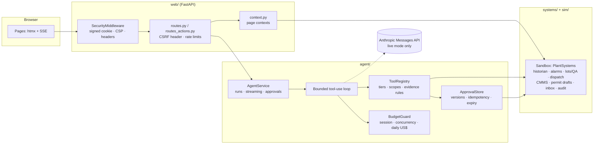

# Architecture

ColdLine is one Python process: FastAPI serving server-rendered pages, an in-process agent service, and one
sandboxed plant per visitor. This document explains how the pieces fit and why.

## Layers



| Layer | Package | Responsibility | Depends on |
|---|---|---|---|
| Contracts | `contracts.py` | Pydantic models and the `PlantSystems` protocol | nothing |
| Simulator | `sim/` | Minute-resolution telemetry, scenarios, freshness and divergence functions | contracts |
| Systems | `systems/` | `Sandbox` (one visitor's plant and business systems), `SessionManager` | sim, contracts |
| Agent | `agent/` | Tool registry, loop, evidence checks, approvals, budget, replay | contracts, `sim.analysis` |
| Web | `web/` | Routes, sessions, security, page contexts, templates, static assets | agent (public API), contracts |

The agent never imports `systems`; the web layer never reaches into agent internals. The seam is the
`PlantSystems` protocol: replace the sandbox with adapters to real systems and the agent does not change.

## A request, end to end

1. `SecurityMiddleware` reads the signed `coldline_session` cookie (or mints a new one), puts the session
   id on the request, and adds the security headers to the response.
2. The `visitor` dependency fetches that visitor's `Sandbox` from `SessionManager` (creating it if needed,
   subject to a per-IP limit on new sandboxes) and advances its clock by the wall time since the last request.
3. GET routes build a page context from the sandbox and the agent service and render a template.
4. POST routes first pass `limit_posts` (the `X-ColdLine` header that htmx sends, `Origin` check, per-IP
   limit). Controls return the whole overview, from which htmx swaps `#overview` (and the clock).

## The hero flow

```mermaid
sequenceDiagram
  participant B as Browser
  participant W as Web
  participant A as AgentService
  participant P as Sandbox
  B->>W: POST /session/inject {probe_mismatch}
  W->>P: inject(scenario)
  W->>A: start_run(session, plant, mode)
  W-->>B: overview with sse-connect=/runs/R-…/stream
  B->>W: GET /runs/R-…/stream (SSE)
  loop each step
    A->>P: tool call (tier-checked)
    W-->>B: event step / trace-step / approval
  end
  W-->>B: event conclusion, done (stream closes, page region re-renders)
  B->>W: POST /approvals/AP-…/approve
  W->>A: approve(…, "Shift Supervisor", plant)
  A->>P: re-read source versions → execute once → audit
  B->>W: POST /session/stale {TT-402}
  W->>P: make_stale
  W->>A: revalidate_approvals → EXPIRED; start_run (stale recording)
```

## The agent loop

A run is at most 8 model calls. Each call sees the frozen system prompt and tool definitions (cached), then
the conversation so far. Every tool call goes through `ToolRegistry.execute`, which checks the tool exists,
is not NEVER tier, matches the agent's scopes, validates arguments, and applies the evidence rules (for
example: no citations of records the run never read; no dispatch change while the evidence is stale). The
run ends when the handover note is accepted or a bound is hit. Details are in
[the agent README](../src/coldline/agent/README.md).

**Replay** feeds recorded model turns through the same loop, so the tools, checks, holds and approvals are
real for the visitor's sandbox while the model cost is zero. **Live** calls the API under the budget guard
and falls back to replay, visibly, on any cap, timeout or error.

## Streaming

`GET /runs/{id}/stream` is server-sent events. Each step is sent twice, as an agent-panel card (`step`)
and a run-page timeline row (`trace-step`), both with the step number as the event id. A proposal is sent
(`approval`) with the step that queued it. The stream ends with `conclusion` and `done`; the page closes
the connection on `done` and re-renders its region so totals, holds and the mimic are final. A reconnect
sends `Last-Event-ID` and resumes after the last step the browser saw.

## State and lifecycle

| State | Where | Lifetime |
|---|---|---|
| Visitor sandbox (plant, lots, work orders, holds, audit) | `SessionManager` | 2 h idle TTL, 200 sandboxes max (oldest evicted) |
| Runs, approvals | `AgentService`, keyed by session | Dropped when the sandbox expires or is evicted |
| Mode, approver role, focused chiller | `Runtime.prefs` | Same as the sandbox |
| Daily live spend | `BudgetGuard`, persisted to `$COLDLINE_DATA_DIR` | UTC day |

All of it is in memory in one process, deliberately: a public demo needs isolation and a hard ceiling on
memory more than durability. [ADR 0004](adr/0004-in-memory-per-visitor-sandboxes.md) records the trade-off
and the HANDOVER guide lists what changes for a real deployment.

## Deployment

One container (`Dockerfile`, Python 3.13 slim, uv) on Fly.io in Sydney, one `shared-cpu-1x` machine with
512 MB, health check on `/healthz`. `COLDLINE_ENV=production` hides the fixture preview routes and marks
cookies `Secure`; the client IP for rate limiting comes from the proxy's `Fly-Client-IP` header. The only
secret is `ANTHROPIC_API_KEY`, set as an environment variable on the host.
